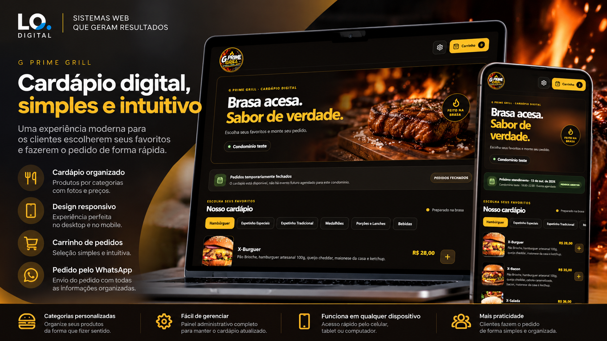
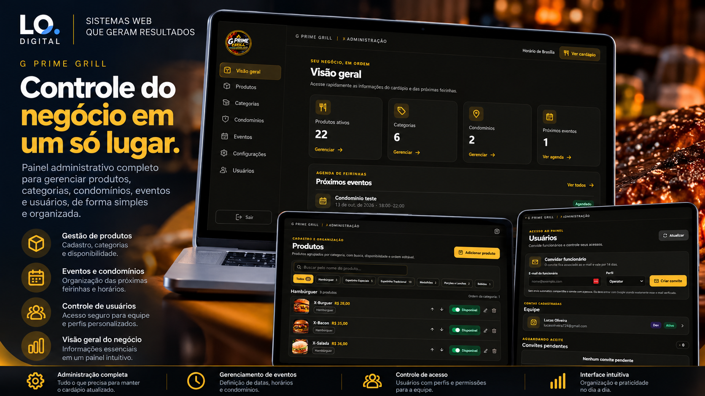
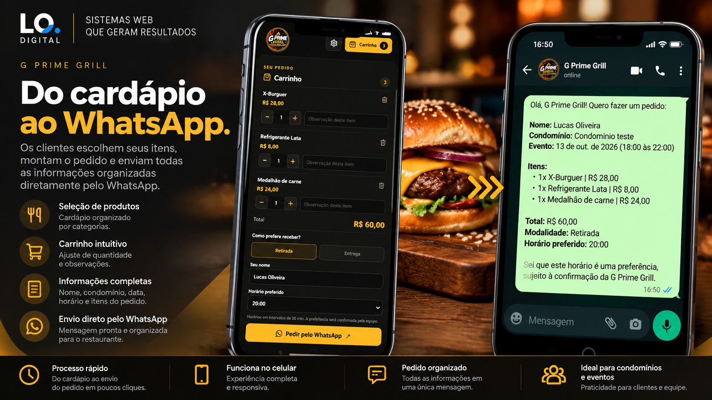

# G Prime Grill

### Cardápio digital e gestão de pedidos

Solução digital para gestão de cardápio e pedidos, com uma interface responsiva para clientes e um painel administrativo para organizar produtos, categorias, condomínios e eventos.

> Este repositório reúne materiais de apresentação do projeto. Não inclui o código-fonte da aplicação.

---

## Visão do projeto

O G Prime Grill combina a experiência pública do cardápio digital com ferramentas administrativas. O cliente consulta o cardápio, monta seu pedido e encaminha os dados pelo WhatsApp para confirmação do estabelecimento.

  

---

## Funcionalidades apresentadas

- Cardápio digital com interface responsiva para clientes.
- Painel administrativo.
- Gestão de produtos e categorias.
- Organização de condomínios e eventos.
- Montagem do pedido pelo cliente.
- Encaminhamento dos dados do pedido pelo WhatsApp para confirmação do estabelecimento.

  

  

---

## Tecnologias

`React` · `TypeScript` · `Vite` · `Firebase`

---

## Fluxo do pedido

O cliente monta o pedido a partir do cardápio e encaminha as informações pelo WhatsApp. A confirmação é realizada pelo estabelecimento.

---

## Desenvolvedor

**Lucas Oliveira**

Desenvolvedor de Soluções Digitais | Martech & Salesforce

[LinkedIn](https://www.linkedin.com/in/lucas-oliveira-7948b494/)
